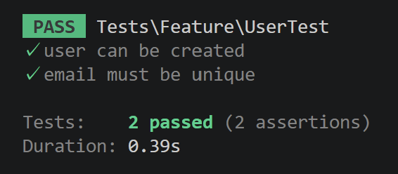

# testing-app-practice

## 概要
COACHTECH 教材 Tutorial 10-5「テスト ハンズオン演習」で作成した成果物です。
ユーザーを問題なくデータベースに登録できるか、重複したメールアドレスを登録しようとすると例外が発生するかを確認するためのテストを作成しました。テストを実行結果が「PASS」となりテストが成功することを確認しました。

## 使用技術
- PHP 8.2.36
- Laravel 10.50.4
- PHPUnit（テスト）
- Eloquent / Factory

## 学んだこと
- Featureテスト（機能テスト）とUnitテスト（単体テスト）の違いと使い分け
- RefreshDatabaseトレイトを使用することでテストごとにデータベースをロールバックする方法
- assertDatabaseHas()やexpectException()のようなアサーションメソッドの使い方

## 動作確認
1. testing-app-practiceディレクトリ上でsail up -dコマンドによりyamlファイルに記述した構成通りのコンテナを起動させてネットワークで連携
2. sail artisan migrateコマンドによりテーブルを作成
3. sail artisan test --filter=UserTestコマンドによりUserTestクラス内の2つのテストメソッドを対象にテストを実行
4. 結果が「PASS」となり、クラスのパスやメソッド名（test_は省略）などの情報が表示されることを確認

## 開発の工夫
- テストメソッド名は何をテストするためのメソッドであるか分かりやすい名前にした
- ユーザー登録の確認を行う際は、nameカラムだけでなくemailカラムも加えることで、特定のレコードを正確に検証できるようにした

## 教材の書き方との違いによる学び
- 自分のメールアドレス重複時の例外テストのコードではnameカラムとemailカラムの値を指定しているが、教材のテストではemailカラムの値のみ指定してる  
┗今回の確認対象のemailカラム以外にも指定をしていると想定と異なるところで例外が発生する可能性があるため、場合によっては対象のカラムに絞るのも良い
- テストの目的によって特定のレコードに絞るためカラム数を増やしたり、テスト対象の部分を正確に確認するためにカラム数を絞ったりと使い分けられると良い

## 動作確認のスクリーンショット
1. テスト実行後の出力結果

   